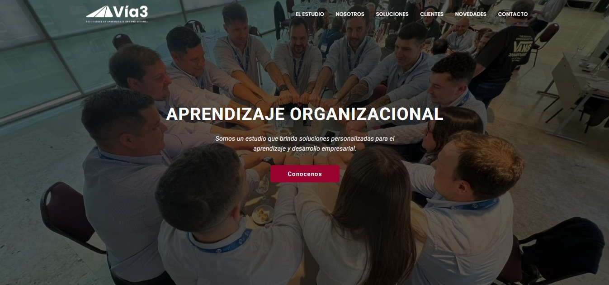
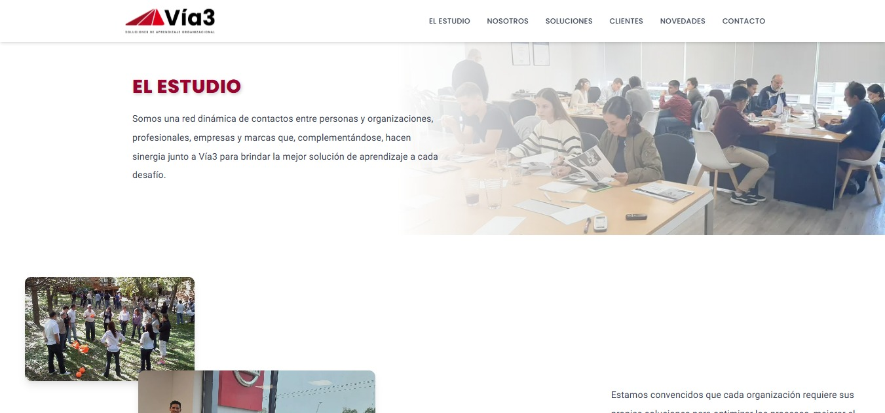
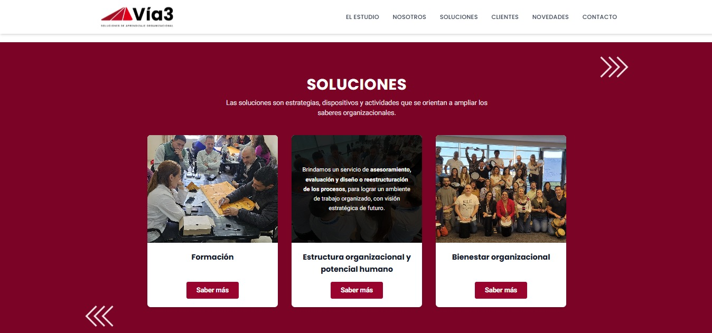
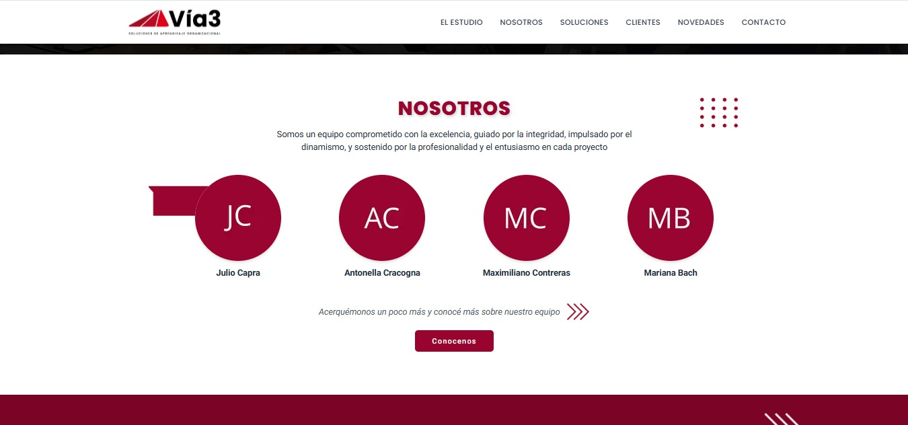
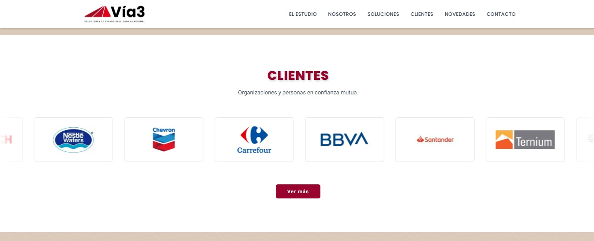
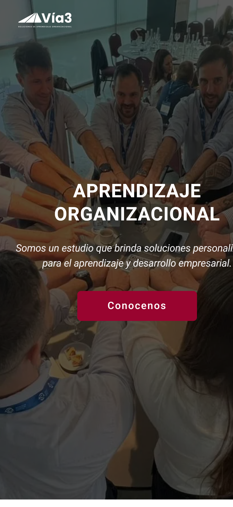
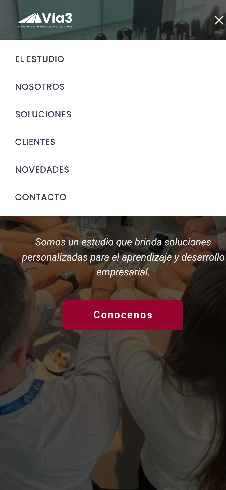
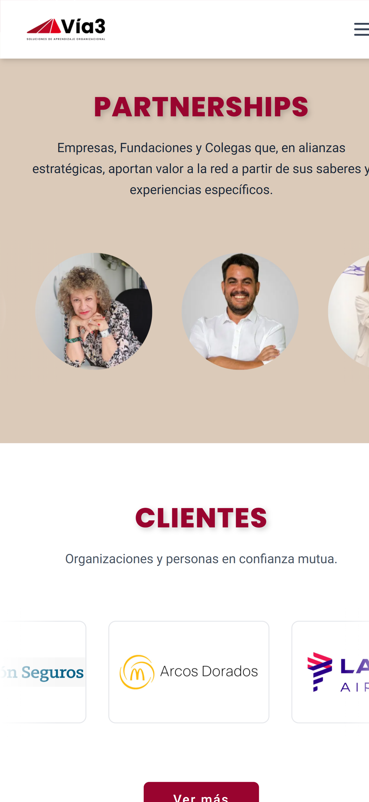

# Estudio Vía3 — Sitio institucional

Sitio web institucional para **Estudio Vía3**, desarrollado de forma freelance. El sitio presenta los servicios, el equipo, los partners y los clientes del estudio. La sección de novedades se gestiona desde un CMS, así que el cliente puede publicar contenido sin tocar código.

> 🚧 **Estado:** en desarrollo. El deploy a producción en [estudiovia3.com.ar](https://estudiovia3.com.ar) está pendiente de la verificación del dominio.



---

## 📑 Índice

- [Stack tecnológico](#-stack-tecnológico)
- [Funcionalidades](#-funcionalidades)
- [Secciones del sitio](#-secciones-del-sitio)
- [Estructura del proyecto](#-estructura-del-proyecto)
- [Instalación y uso local](#-instalación-y-uso-local)
- [Variables de entorno](#-variables-de-entorno)
- [Sanity CMS](#-sanity-cms)
- [Decisiones técnicas](#-decisiones-técnicas)
- [Capturas](#-capturas)
- [Autora](#-autora)

---

## 🛠 Stack tecnológico

| Tecnología | Uso |
|---|---|
| **Next.js** (App Router) + **TypeScript** | Framework principal, routing y renderizado |
| **Tailwind CSS** | Estilos y diseño responsive |
| **Sanity CMS** | Contenido autogestionable (Novedades) |
| **Cloudinary** | Hosting y optimización de imágenes |
| **Resend** | Envío de emails desde el formulario de contacto |

---

## ✨ Funcionalidades

- **Contenido autogestionable:** el cliente carga y edita las novedades desde Sanity Studio, sin depender de un desarrollador.
- **Formulario de contacto funcional:** los mensajes llegan por email vía Resend. El formulario es un componente reutilizable con dos variantes visuales: oscura y texturada dentro del modal, y clara en la sección de contacto.
- **Carruseles animados propios:** tienen scroll infinito implementado con `requestAnimationFrame`, sin librerías externas.
- **Modales accesibles:** se cierran con la X, con un click en el fondo o con la tecla `Esc`.
- **Navbar dinámica:** pasa de transparente a sólida según el scroll.
- **Hover adaptado a cada dispositivo:** usa un custom variant de Tailwind (`can-hover`) para que los efectos hover solo se apliquen en dispositivos que los soportan.
- **Diseño responsive** para mobile, tablet y desktop.

---

## 🧩 Secciones del sitio

| Sección | Descripción |
|---|---|
| **Hero** | Presentación principal del estudio |
| **Navbar** | Navegación con transparencia según el scroll |
| **Vía3 / Qué proponemos** | Presentación con un mosaico de fotos que rotan con crossfade (se pausa fuera de pantalla) |
| **Cómo trabajamos** | 4 principios con íconos sobre círculo bordó (`mix-blend-mode: screen`) |
| **Equipo** (ex Nosotros) | Grilla del equipo y una página `/equipo` con el detalle de cada integrante (query params en la URL) |
| **Soluciones** | Cards con overlay en hover; el botón "Saber más" abre un modal con el detalle y un formulario de consulta |
| **Partnerships** | Carrusel infinito con desplazamiento automático |
| **Experiencia** (ex Clientes) | Carrusel de logos y una página `/experiencia` con la grilla completa |
| **Ideas** (ex Novedades) | Contenido dinámico que se obtiene de Sanity CMS, con una página `/ideas` |
| **Contacto** | Formulario conectado con Resend |
| **Footer** | Carrusel con las dos sedes, acceso a WhatsApp y Google Maps |

---

## 📁 Estructura del proyecto

```
estudio-via3/
├── src/
│   ├── app/                 # Rutas (App Router)
│   ├── components/          # Componentes reutilizables (SolucionForm, SolucionModal, etc.)
│   ├── data/                # Datos estáticos: clientes, equipo, partners, soluciones
│   └── sanity/              # Cliente, queries y schemas de Sanity
├── public/                  # Assets estáticos
├── sanity.config.ts         # Configuración de Sanity Studio
├── sanity.cli.ts            # Configuración del CLI de Sanity
├── next.config.ts
└── package.json
```

---

## 🚀 Instalación y uso local

**Requisitos:** Node.js 18 o superior y npm.

```bash
# 1. Clonar el repositorio
git clone https://github.com/FlorenciaCracogna/estudio-via3.git
cd estudio-via3

# 2. Instalar dependencias
npm install

# 3. Configurar las variables de entorno (ver la sección siguiente)
cp .env.example .env.local

# 4. Levantar el servidor de desarrollo
npm run dev
```

El sitio queda disponible en [http://localhost:3000](http://localhost:3000).

### Scripts disponibles

| Comando | Descripción |
|---|---|
| `npm run dev` | Servidor de desarrollo |
| `npm run build` | Build de producción |
| `npm run start` | Sirve el build de producción |
| `npm run lint` | Ejecuta ESLint |

---

## 🔐 Variables de entorno

Creá un archivo `.env.local` en la raíz del proyecto con estas variables:

```env
# Sanity
NEXT_PUBLIC_SANITY_DATASET="production"
NEXT_PUBLIC_SANITY_PROJECT_ID=
SANITY_REVALIDATE_SECRET=

# Resend
RESEND_API_KEY=
CONTACT_EMAIL=
```

---

## 📝 Sanity CMS

La sección **Novedades** se alimenta desde Sanity. Para abrir el Studio de forma local:

```bash
npx sanity dev
```

Desde el Studio se pueden crear, editar y publicar novedades. Los cambios se reflejan en el sitio sin necesidad de un nuevo deploy.

---

## 💡 Decisiones técnicas

- **El detalle de Soluciones es un modal y no una página aparte.** El usuario mantiene el contexto de la página y el flujo hacia la consulta es más corto. El formulario de contacto se reutiliza dentro del modal con una variante visual distinta.
- **Los carruseles usan `requestAnimationFrame` en lugar de una librería.** Así tengo control total sobre la velocidad y la fluidez, y el bundle queda más liviano.
- **El contenido está separado en dos tipos.** El contenido estable (equipo, clientes, partners, soluciones) está en archivos `data/*.ts` tipados. El contenido que cambia seguido (novedades) está en Sanity. Esto mantiene el CMS simple para el cliente.
- **Las imágenes están en Cloudinary.** Se optimizan y se sirven desde una CDN, y el repositorio queda más liviano.
- **Actualización de contenido en dos capas:** la Live Content API de Sanity (`<SanityLive />`) refleja los cambios en tiempo real mientras hay visitantes en el sitio. Además, un webhook (`/api/revalidate`) limpia el caché de Next.js cada vez que se crea, edita o borra una novedad. Así, los cambios del cliente se ven siempre, aunque nadie tenga el sitio abierto en ese momento.

---

## 📸 Capturas

### Desktop

| Home | Soluciones |
|---|---|
|  |  |

| Nosotros | Clientes |
|---|---|
|  |  |

### Mobile

<p align="center">
  
  
  
</p>

---

## 👩‍💻 Autora

**Florencia Cracogna**, Fullstack Developer

- Portfolio: [florenciacracogna.vercel.app](https://florenciacracogna.vercel.app)
- LinkedIn: [linkedin.com/in/florencia-cracogna](https://linkedin.com/in/florencia-cracogna)
- GitHub: [@FlorenciaCracogna](https://github.com/FlorenciaCracogna)

---

Proyecto desarrollado para **Estudio Vía3** y publicado con autorización del cliente.
