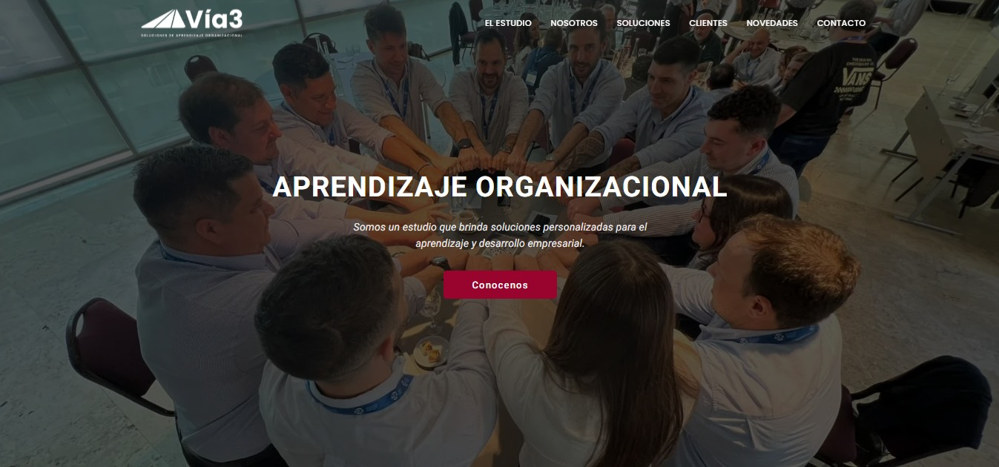
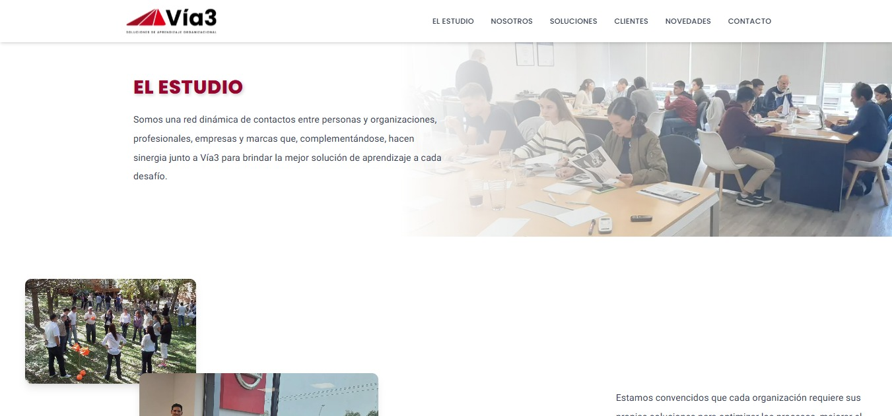
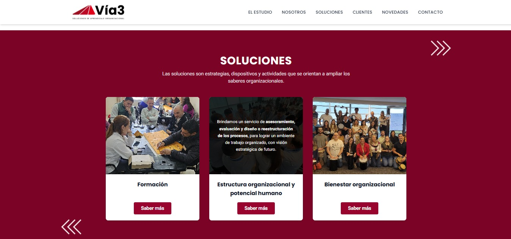
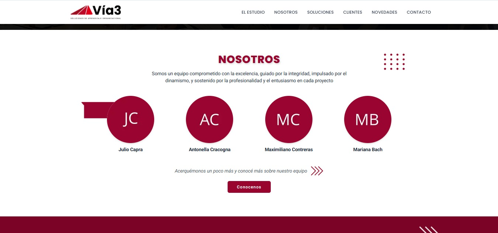
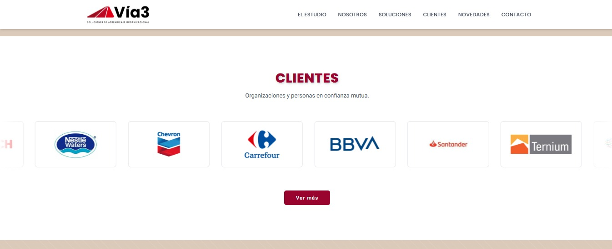
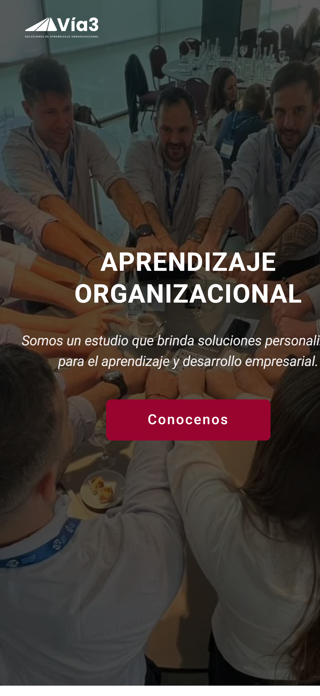
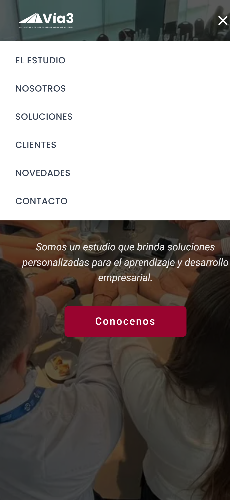
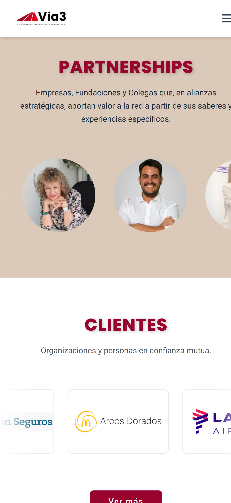

# Estudio Vía3 — Sitio institucional

Sitio web institucional para **Estudio Vía3**, desarrollado de forma freelance. El sitio presenta los servicios, el equipo, los partners y los clientes del estudio. La sección de novedades se gestiona desde un CMS, así que el cliente puede publicar contenido sin tocar código.

> 🚧 **Estado:** en desarrollo. El deploy a producción en [estudiovia3.com.ar](https://estudiovia3.com.ar) está pendiente de la verificación del dominio.



---

## 📑 Índice

- [Stack tecnológico](#-stack-tecnológico)
- [Funcionalidades](#-funcionalidades)
- [Secciones del sitio](#-secciones-del-sitio)
- [Estructura del proyecto](#-estructura-del-proyecto)
- [Instalación y uso local](#-instalación-y-uso-local)
- [Variables de entorno](#-variables-de-entorno)
- [Sanity CMS](#-sanity-cms)
- [Decisiones técnicas](#-decisiones-técnicas)
- [Deploy en Netlify](#️-deploy-en-netlify)
- [Capturas](#-capturas)
- [Autora](#-autora)

---

## 🛠 Stack tecnológico

| Tecnología | Uso |
|---|---|
| **Next.js** (App Router) + **TypeScript** | Framework principal, routing y renderizado |
| **Tailwind CSS** | Estilos y diseño responsive |
| **Sanity CMS** | Contenido autogestionable (Novedades) |
| **Cloudinary** | Hosting y optimización de imágenes |
| **Resend** | Envío de emails desde el formulario de contacto |

---

## ✨ Funcionalidades

- **Contenido autogestionable:** el cliente carga y edita las novedades desde Sanity Studio, sin depender de un desarrollador.
- **Formulario de contacto funcional:** los mensajes llegan por email vía Resend. El formulario es un componente reutilizable con dos variantes visuales: oscura y texturada dentro del modal, y clara en la sección de contacto.
- **Carruseles animados propios:** tienen scroll infinito implementado con `requestAnimationFrame`, sin librerías externas.
- **Modales accesibles:** se cierran con la X, con un click en el fondo o con la tecla `Esc`.
- **Navbar dinámica:** pasa de transparente a sólida según el scroll.
- **Hover adaptado a cada dispositivo:** usa un custom variant de Tailwind (`can-hover`) para que los efectos hover solo se apliquen en dispositivos que los soportan.
- **Diseño responsive** para mobile, tablet y desktop.

---

## 🧩 Secciones del sitio

| Sección | Descripción |
|---|---|
| **Hero** | Presentación principal del estudio |
| **Navbar** | Navegación con transparencia según el scroll |
| **Vía3 / Qué proponemos** | Presentación con un mosaico de fotos que rotan con crossfade (se pausa fuera de pantalla) |
| **Cómo trabajamos** | 4 principios con íconos de Cloudinary (`mix-blend-mode: screen`) |
| **Equipo** (ex Nosotros) | Cards con foto, rol, especialidad y LinkedIn de cada integrante (`/equipo` y `/nosotros` redirigen a `/#equipo`) |
| **Soluciones** | 3 cards con descripción visible; "Saber más" abre un modal con las subsoluciones en acordeón y un formulario de consulta (sticky en desktop) |
| **Red de especialistas** (ex Partnerships) | Carrusel infinito (velocidad por tiempo) con flechas, swipe y pausa en hover o fuera de pantalla |
| **Experiencia** (ex Clientes) | Carrusel de logos y una página `/experiencia` con los clientes agrupados por sector en acordeón |
| **Ideas** (ex Novedades) | Contenido dinámico que se obtiene de Sanity CMS, con una página `/ideas` |
| **Contacto** | Formulario conectado con Resend |
| **Footer** | Carrusel con las dos sedes, acceso a WhatsApp y Google Maps |

---

## 📁 Estructura del proyecto

```
estudio-via3/
├── src/
│   ├── app/                 # Rutas (App Router)
│   ├── components/          # Componentes reutilizables (SolucionForm, SolucionModal, etc.)
│   ├── data/                # Datos estáticos: clientes, equipo, partners, soluciones
│   └── sanity/              # Cliente, queries y schemas de Sanity
├── public/                  # Assets estáticos
├── sanity.config.ts         # Configuración de Sanity Studio
├── sanity.cli.ts            # Configuración del CLI de Sanity
├── next.config.ts
└── package.json
```

---

## 🚀 Instalación y uso local

**Requisitos:** Node.js 18 o superior y npm.

```bash
# 1. Clonar el repositorio
git clone https://github.com/FlorenciaCracogna/estudio-via3.git
cd estudio-via3

# 2. Instalar dependencias
npm install

# 3. Configurar las variables de entorno (ver la sección siguiente)
cp .env.example .env.local

# 4. Levantar el servidor de desarrollo
npm run dev
```

El sitio queda disponible en [http://localhost:3000](http://localhost:3000).

### Scripts disponibles

| Comando | Descripción |
|---|---|
| `npm run dev` | Servidor de desarrollo |
| `npm run build` | Build de producción |
| `npm run start` | Sirve el build de producción |
| `npm run lint` | Ejecuta ESLint |

---

## 🔐 Variables de entorno

Creá un archivo `.env.local` en la raíz del proyecto con estas variables:

```env
# Sanity
NEXT_PUBLIC_SANITY_DATASET="production"
NEXT_PUBLIC_SANITY_PROJECT_ID=
SANITY_REVALIDATE_SECRET=

# Resend
RESEND_API_KEY=
CONTACT_EMAIL=
```

---

## 📝 Sanity CMS

La sección **Novedades** se alimenta desde Sanity. Para abrir el Studio de forma local:

```bash
npx sanity dev
```

Desde el Studio se pueden crear, editar y publicar novedades. Los cambios se reflejan en el sitio sin necesidad de un nuevo deploy.

---

## 💡 Decisiones técnicas

- **El detalle de Soluciones es un modal y no una página aparte.** El usuario mantiene el contexto de la página y el flujo hacia la consulta es más corto. El formulario de contacto se reutiliza dentro del modal con una variante visual distinta.
- **Los carruseles usan `requestAnimationFrame` en lugar de una librería.** Así tengo control total sobre la velocidad y la fluidez, y el bundle queda más liviano.
- **El contenido está separado en dos tipos.** El contenido estable (equipo, clientes, partners, soluciones) está en archivos `data/*.ts` tipados. El contenido que cambia seguido (novedades) está en Sanity. Esto mantiene el CMS simple para el cliente.
- **Las imágenes están en Cloudinary.** Se optimizan y se sirven desde una CDN, y el repositorio queda más liviano.
- **Actualización de contenido en dos capas:** la Live Content API de Sanity (`<SanityLive />`) refleja los cambios en tiempo real mientras hay visitantes en el sitio. Además, un webhook (`/api/revalidate`) limpia el caché de Next.js cada vez que se crea, edita o borra una novedad. Así, los cambios del cliente se ven siempre, aunque nadie tenga el sitio abierto en ese momento.

---

## ☁️ Deploy en Netlify

El sitio está preparado para el plan gratuito de Netlify:

- [`netlify.toml`](netlify.toml) define el comando de build (`npm run build`) y la versión de Node, la misma que en desarrollo. Netlify detecta Next.js e instala su runtime solo, así que no hace falta declararlo ni fijar su versión.
- Las imágenes **no pasan por el Image CDN de Netlify**. Un loader global ([`src/lib/image-loader.ts`](src/lib/image-loader.ts)) las pide directo a Cloudinary o a Sanity, que hacen el resize. Así no consumen ancho de banda de Netlify. El loader no depende de la plataforma: funciona igual en Vercel o en local.

### 1. Crear el sitio

En Netlify: **Add new project → Import an existing project → GitHub**, elegir este repositorio y `main` como rama de producción. La configuración de build se toma de `netlify.toml`.

### 2. Variables de entorno

Se cargan en **Project configuration → Environment variables**, con todos los scopes (Builds y Functions) y todos los contextos (Production y Deploy Previews):

| Variable | Para qué | Nota |
|---|---|---|
| `NEXT_PUBLIC_SANITY_PROJECT_ID` | Proyecto de Sanity | Se lee **en el build**: sin ella, el build falla |
| `NEXT_PUBLIC_SANITY_DATASET` | Dataset (`production`) | Se lee **en el build** |
| `SANITY_REVALIDATE_SECRET` | Firma del webhook de `/api/revalidate` | Secreta. Tiene que coincidir con el *secret* del webhook |
| `RESEND_API_KEY` | Envío de mails del formulario | Secreta |
| `CONTACT_EMAIL` | Casilla que recibe las consultas | |

`NEXT_PUBLIC_SANITY_API_VERSION` es opcional (por defecto `2026-06-30`). Si cambia una variable `NEXT_PUBLIC_*`, hay que volver a deployar, porque queda fija en el build.

### 3. CORS de Sanity

En [sanity.io/manage](https://www.sanity.io/manage) → proyecto → **API → CORS origins**, agregá:

| Origen | Allow credentials |
|---|---|
| `https://<nombre-del-sitio>.netlify.app` | ✅ |
| `https://estudiovia3.com.ar` (y `https://www.estudiovia3.com.ar` si se usa) | ✅ |

Las credentials hacen falta para iniciar sesión en el Studio embebido (`/studio`). Sin el origen, además, `<SanityLive />` no se conecta y en la consola aparece un error de CORS. **No uses un comodín como `https://*.netlify.app` con credentials:** cualquier sitio de Netlify quedaría habilitado. Para probar el Studio en un deploy preview, agregá esa URL puntual y borrala después.

### 4. Webhook de Sanity

En **API → Webhooks → Create webhook**:

- **URL:** `https://estudiovia3.com.ar/api/revalidate`. Mientras no esté el dominio, usá la URL `.netlify.app`, y si existía un webhook que apuntaba a Vercel, actualizalo.
- **Dataset:** `production`
- **Trigger on:** Create, Update y Delete
- **Filter:** `_type == "novedad"`
- **HTTP method:** POST
- **Secret:** el mismo valor que `SANITY_REVALIDATE_SECRET`

Para probarlo, editá una novedad y fijate en **Webhooks → Attempts log**: tiene que responder `200 {"revalidated": true}`. Un `401` indica que el secret no coincide.

### 5. Cuidar los créditos del plan gratuito

El plan gratuito tiene **300 créditos por mes con tope duro**: si se agotan, el sitio deja de servirse hasta el mes siguiente. Cada deploy a producción cuesta 15 créditos y cada GB de ancho de banda, 20.

- **Iterar en deploy previews:** abrir un PR contra `main` genera un preview que **no consume créditos**, igual que los deploys de ramas y los deploys fallidos.
- **Mergear a `main` en lote:** juntar varios cambios en un solo merge, porque cada push a `main` es un deploy de producción.
- **Publicar contenido no cuesta deploys:** las novedades de Sanity se actualizan con el webhook y Live, sin rebuild.
- **Revisar el consumo** en **Team → Billing → Usage**, sobre todo el primer mes.

> Si el build falla con un `Module not found` de `next/font/google` (Roboto/Poppins), es un error intermitente al descargar las fuentes. Se resuelve con **Retry deploy → Clear cache and deploy site**.

### Plan B: si el build falla por `proxy.ts`

[`src/proxy.ts`](src/proxy.ts) redirige `/equipo` y `/nosotros` (con cualquier `?miembro=`) a `/#equipo` con un 301, y descarta el query string. Hay un reporte de que con `@netlify/plugin-nextjs` 5.16.x el build de Next 16 falla con `proxy.ts`. El error es un `ENOENT` en `copyTracedFiles` que menciona `proxy.js`. Si pasa, probá en este orden:

1. **Fijar el runtime a 5.15.x** (con la 5.15.13 se reportó que funciona). Netlify no lo recomienda porque se dejan de recibir las actualizaciones automáticas, así que conviene sacarlo cuando salga el arreglo.

   ```bash
   npm install -D @netlify/plugin-nextjs@5.15.13
   ```

   Y en [`netlify.toml`](netlify.toml):

   ```toml
   [[plugins]]
     package = "@netlify/plugin-nextjs"
   ```

   Para volver a la versión automática, borrá el bloque `[[plugins]]` y la dependencia de `package.json`.

2. **Volver a la convención anterior, `middleware.ts`.** Renombrá `src/proxy.ts` a `src/middleware.ts` y la función `proxy` a `middleware`. El resto del archivo queda igual. Next 16 lo marca como deprecado, pero sigue funcionando y en Netlify corre como Edge Function.

3. **Último recurso: una regla de Netlify.** Ojo: los redirects de Netlify pasan el query string al destino, igual que los de `next.config`. `/equipo?miembro=1` terminaría en `/?miembro=1#equipo`. El home ignora el parámetro, así que funciona, pero la URL queda sucia. Además, la documentación de Netlify no aclara si acepta un `#fragmento` en el destino, así que hay que probarlo en un deploy preview.

   ```toml
   [[redirects]]
     from = "/equipo"
     to = "/#equipo"
     status = 301
     force = true

   [[redirects]]
     from = "/nosotros"
     to = "/#equipo"
     status = 301
     force = true
   ```

   Si se usa esta opción, hay que borrar `src/proxy.ts`.

---

## 📸 Capturas

### Desktop

| Home | Soluciones |
|---|---|
|  |  |

| Nosotros | Clientes |
|---|---|
|  |  |

### Mobile

<p align="center">
  
  
  
</p>

---

## 👩‍💻 Autora

**Florencia Cracogna**, Fullstack Developer

- Portfolio: [florenciacracogna.vercel.app](https://florenciacracogna.vercel.app)
- LinkedIn: [linkedin.com/in/florencia-cracogna](https://linkedin.com/in/florencia-cracogna)
- GitHub: [@FlorenciaCracogna](https://github.com/FlorenciaCracogna)

---

Proyecto desarrollado para **Estudio Vía3** y publicado con autorización del cliente.
